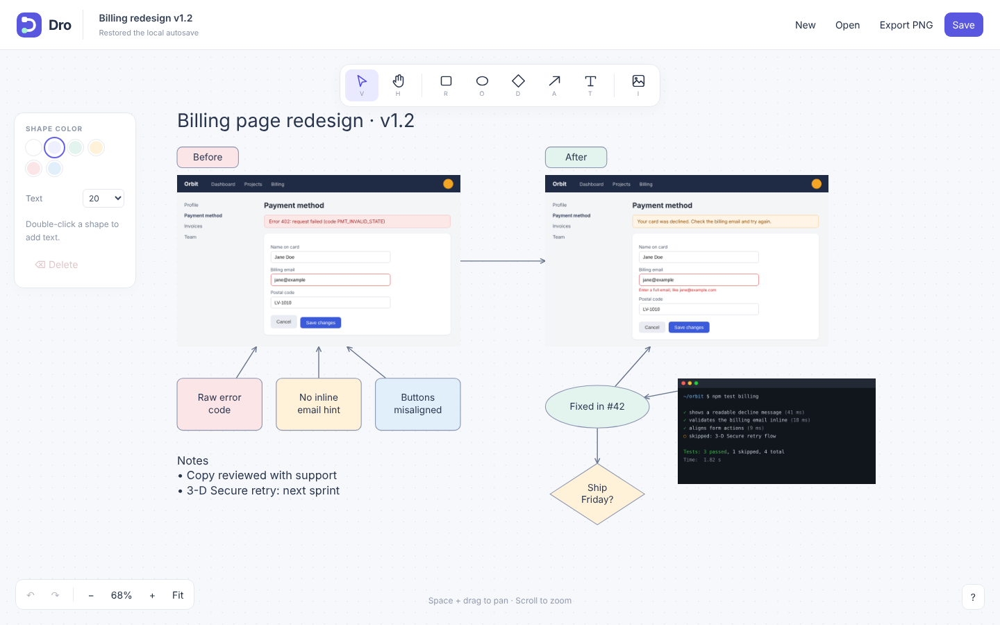

# Dro

A small, personal drawing tool in one HTML file. Sketch a diagram, add a screenshot, save it locally.

**[Try it in your browser →](https://airokz.github.io/Dro/)** · [Download `whiteboard.html`](whiteboard.html)



## Use it

Use the [live demo](https://airokz.github.io/Dro/) (it is the same file and still makes no network calls once loaded), or download `whiteboard.html` and open it in a desktop browser. That is the whole application, including its logo and favicon. No install, build step, server, account, or internet connection is required.

- Draw rectangles, ellipses, diamonds, text, and arrows. Hold Shift while drawing for a perfect square or circle.
- Add images with the image button, file drag-and-drop, or Cmd/Ctrl+V.
- Move and resize objects. Image proportions stay fixed unless you hold Shift; other shapes keep their proportions while you hold Shift.
- Select everything with Cmd/Ctrl+A, then drag, recolor, change the font size, or delete it all at once.
- Drag either arrow endpoint to any position along an object's outline. Attachments follow the object when it moves or resizes.
- Save editable JSON with images embedded, or export the drawing as PNG.
- Undo, redo, zoom, pan, and fit the drawing to the screen.

Double-click a shape to edit its text. Select an arrow by its line or endpoints; dragging the line moves the whole arrow and detaches both ends.

## Shortcuts

| Key                | Action                        |
| ------------------ | ----------------------------- |
| V                  | Select                        |
| H or Space + drag  | Pan                           |
| R / O / D          | Rectangle / ellipse / diamond |
| A / T / I          | Arrow / text / image          |
| Shift + draw       | Perfect square / circle       |
| Cmd/Ctrl+A         | Select all                    |
| Esc                | Deselect                      |
| Cmd/Ctrl+S         | Save JSON                     |
| Cmd/Ctrl+Z         | Undo                          |
| Cmd/Ctrl+Shift+Z   | Redo                          |
| Delete / Backspace | Delete selection              |
| Cmd/Ctrl+Enter     | Finish editing text           |
| Mouse wheel        | Zoom                          |

## Your files and privacy

Dro has no analytics, accounts, remote fonts, or network calls. Your drawing stays in browser memory, browser storage, and files you choose to save. Exported JSON contains embedded images: treat it as the complete drawing when sharing it.

**Save important work to JSON.** Autosave is a best-effort local copy, not a backup. Storage can be unavailable, full, cleared, or tied to the location of the HTML file. Private browsing may discard it. Saving downloads a new file; it does not overwrite an opened file. Open a saved JSON file through **Open** to continue editing.

Images up to 30 MB are converted to PNG, with the longest edge limited to 4096 pixels. SVG icons are rasterized and GIFs become still images. JSON imports are limited to 100 MB and 5,000 objects. Large images or drawings can still use substantial memory.

## Scope and browser support

Dro is a personal desktop canvas, not a collaborative editor. It currently selects one object at a time. Canvas objects do not yet have full keyboard or screen-reader navigation.

Tested in desktop Chrome. Other browsers may work, but Firefox and Safari have not been verified. Image paste depends on your browser and clipboard contents; a copied file path is not image data. Use the image button or drag-and-drop if pasting does not work.

## Development

Edit `whiteboard.html` and reload it. The code is formatted with [Prettier](https://prettier.io) (settings in `.prettierrc`); run `npx prettier --write whiteboard.html tests` before opening a pull request so diffs stay readable. Keep the application self-contained: no runtime dependencies, CDN assets, bundler, or backend. The repository's tests and documentation are not needed to run it.

Browser regression tests use Node.js, Playwright Core, and an installed Chrome browser. Install the test dependency, then run:

```sh
npm install --no-save --package-lock=false playwright-core@1.61.1
node tests/smoke.cjs
node tests/arrows.cjs
node tests/anchors.cjs
node tests/memory.cjs
```

`CHROME_PATH` overrides Chrome's executable path; Windows users need to set it. `PLAYWRIGHT_MODULE` optionally points to an existing Playwright Core installation. Tests open the HTML using `file://` and cover image manipulation, arrows, text editing, undo/redo, file round-trips, and absence of outgoing HTTP requests. Clipboard tests simulate browser events; native OS clipboard integration is not automated.

Small, focused fixes are welcome. Include reproduction steps and relevant tests, preserve existing saved files, and keep the single-file design. Do not include private drawings or screenshots in issue reports. The internal `list-whiteboard` identifiers are retained for compatibility with earlier files.

## License

[Apache License 2.0](LICENSE). The standalone HTML also includes the license so it can be shared on its own. This license covers Dro's code and bundled artwork, not drawings or images you create or import.
